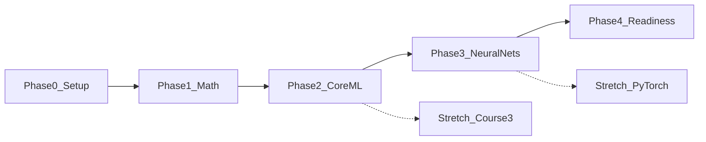

# Roadmap

Five phases, twelve weeks, one outcome: you can start a master's ML course ready to follow the lectures. Hours below are the core lane. Stretch sits on top and is specified in [03-weekly-schedule.md](03-weekly-schedule.md). When a phase total and the schedule differ by an hour or two, follow the schedule. Week 3 finishes the math. Course 1 starts in week 4.



## If time collapses

Protect these, in order, and let everything else wait:

1. The gradient-descent exercise.
2. Machine Learning Specialization, Course 1, labs included.
3. The credit-default project.
4. Course 2, Week 1 (what a neuron computes) and Week 3 (bias, variance, and the development process).
5. The day-1 self-test in the tracker.

Course 2's optional backpropagation video and the NumPy network are the next things to restore. Course 3, fast.ai, and PyTorch wait until the list above is done.

## Phase 0 — Setup (week 1, about 3–4 hours)

**Outcome.** You can open a notebook and run NumPy, pandas, and scikit-learn. A Kaggle account exists.

**Objectives.**

- A local environment on Python 3.10 or newer. Python 3.12 matches the Géron notebooks.
- Enough NumPy to write a loop-free update: arrays, shapes, broadcasting, `np.dot` or `@`, and `np.sum`.
- Enough pandas to load a CSV, select columns, and count missing values. If you already do this at work, spend the hour on NumPy instead.

**Do this.**

From the repo directory:

```bash
python3 --version
python3 -m venv .venv
source .venv/bin/activate
python -m pip install --upgrade pip
python -m pip install numpy pandas matplotlib scikit-learn jupyter
jupyter lab
```

If `python3` is older than 3.10, install Python 3.12 and use `python3.12 -m venv .venv`. Cap setup at 90 minutes. If the install fights you, switch to [Google Colab](https://colab.research.google.com/) and move on. The Coursera labs run in Coursera's environment either way. The local environment is for the three builds and the Géron notebooks.

Smoke test, in a notebook cell:

```python
import numpy as np
print(np.linspace(0, 1, 5))
```

Create a [Kaggle](https://www.kaggle.com/) account in this phase. You will need it for the pandas practice and for the credit dataset.

**You are done when.** The smoke test prints five numbers, and you can load a CSV into a DataFrame.

## Phase 1 — Math refresher (weeks 1–3, about 15 hours)

**Outcome.** When a lecture says "gradient", "dot product", or "conditional probability", you know which object it is and what to compute.

You have seen this material before. The refresher exists to make it usable again: a set of targeted videos and two short calculations.

**Objectives.**

- Linear algebra: vectors, linear combinations, matrices as transformations, matrix multiplication as composition, the dot product, and the picture of an eigenvector (`Av = λv`).
- Calculus: the derivative as a slope, the chain rule, a partial derivative, and a gradient as the direction of steepest increase.
- Probability: mean and variance, conditional probability, Bayes' theorem, the shape of a Gaussian, and the word "likelihood".

**Study this.**

- 3Blue1Brown, *Essence of Linear Algebra*, episodes 1, 2, 3, 4, 9, and 14. Titles and links are in [02-resources.md](02-resources.md).
- 3Blue1Brown, *Essence of Calculus*, the first four episodes, then Khan Academy's partial-derivative and gradient videos.
- Khan Academy and StatQuest for probability, plus the numerical Bayes exercise below.

**Bayes exercise (about 20 minutes).** Use these made-up lending numbers.

- Prior: `P(default) = 0.07`
- `P(90 days late | default) = 0.60`
- `P(90 days late | no default) = 0.05`

Compute `P(default | 90 days late)`. A correct setup lands near **0.47**. Write one sentence on why the result is so much larger than 0.07.

**Deliverable — gradient descent in one dimension.** In a fresh notebook (a `study/` folder you create is a good home):

- Minimize `f(x) = (x - 3) ** 2`, whose derivative is `2 * (x - 3)`.
- Start at `x = 0`. Run 20 steps with learning rate `0.1`. The iterates should approach 3.
- Run again with learning rate `1.1`. The iterates should diverge or oscillate.
- Plot both runs.
- In a markdown cell, five sentences: what the derivative tells you, how the learning rate changes the step, and why the second run fails.

Use NumPy. Leave scikit-learn for Phase 2.

**Stretch inside this phase.** If the 1D exercise takes under two hours, fit a line `y = wx + b` to synthetic data with mean squared error and the same hand-written update. Course 1 will redo this, and it will feel easier.

**You are done when.** Both plots exist, the five sentences exist, and the Bayes posterior you computed is near 0.47.

## Phase 2 — Core machine learning (weeks 4–8, about 27 hours)

**Outcome.** You can train, evaluate, and criticize a supervised model on a tabular dataset.

**Objectives.**

- Linear regression: the cost, gradient descent, multiple features, feature scaling.
- Logistic regression: probability, decision threshold, overfitting, L2 regularization.
- A real train/test workflow: missing data, leakage, baselines, precision, recall, ROC-AUC.
- The habit of naming the error that matters before you chase a score.

**Study this.**

- Machine Learning Specialization, [Course 1](https://www.coursera.org/learn/machine-learning): Supervised Machine Learning: Regression and Classification. All three weeks, quizzes, and both practice labs. DeepLearning.AI budgets this course at about 15 hours (3 weeks at 5 hours). A working Python developer usually lands near that, because the labs are the time and the syntax is already familiar.
- Géron chapters 1–4, at this depth: read the chapter, run the notebook from [ageron/handson-mlp](https://github.com/ageron/handson-mlp), do one exercise per chapter. That is about 5 hours. Treat the book as a reference you return to.
- Kaggle Learn, [Intro to Machine Learning](https://www.kaggle.com/learn/intro-to-machine-learning), as a short drill in scikit-learn. If a Course 1 lab runs long, this is the item that slides.

Course 1's optional "Conversations with Andrew" can wait. The practice labs cannot.

**Deliverable — credit-default baseline.** One notebook, about 5 hours, on the [Give Me Some Credit](https://www.kaggle.com/competitions/GiveMeSomeCredit/data) training file. Accept the competition rules to download it. The question: rank borrowers by the probability of serious delinquency within two years (`SeriousDlqin2yrs`). Roughly 7 percent of rows are positive. A high accuracy mostly restates that fact.

Include these sections and then stop:

1. **Question.** One paragraph a credit-risk colleague could read.
2. **Profile.** Class rate, missingness, and dtypes. `MonthlyIncome` and `NumberOfDependents` are the columns that usually come in incomplete. The past-due counts use `96` and `98` as special codes, sentinels from the data feed. Write down what you did with those codes.
3. **Split.** Stratified train/validation/test. Fit any scaler on the training fold only.
4. **Baseline.** Logistic regression in scikit-learn.
5. **One improvement.** Either stronger L2/L1 regularization, or one tree model. Stop after that single model.
6. **Metrics.** ROC-AUC on the test set, plus precision and recall at one threshold you chose. Say which lending error that threshold prefers: declining a borrower who would have paid, or funding a borrower who defaults.
7. **Age.** The file contains `age`. Note whether you would keep it in a real scorecard.
8. **Before a real decision.** Three bullets on what you would need before this model touched a decision.

If the Kaggle download is blocked, switch to the [Credit Card Fraud Detection](https://www.kaggle.com/datasets/mlg-ulb/creditcardfraud) dataset and say so at the top of the notebook. The same eight sections apply. Fraud is more imbalanced, so lean harder on precision and recall.

**You are done when.** Course 1's labs are submitted, and the notebook states a test metric, a baseline score, and one next experiment.

## Phase 3 — Neural nets, trees, and generalization (weeks 8–11, about 20 hours)

**Outcome.** You can explain a small neural net, a decision tree, and what to do when training error and validation error disagree.

**Objectives.**

- What one neuron computes: a weighted sum, then a nonlinearity.
- Why a network without nonlinearities collapses to a linear model.
- Training: activations, multiclass outputs, and backpropagation as the chain rule applied to the loss.
- Bias and variance, learning curves, and a data-centric next step.
- Decision trees and the idea of an ensemble.
- Enough contact with imbalanced labels to connect Course 2 to the credit project.

**Study this.**

- Machine Learning Specialization, [Course 2](https://www.coursera.org/learn/advanced-learning-algorithms): Advanced Learning Algorithms. All four weeks and the practice labs. DeepLearning.AI budgets about 20 hours. This calendar plans about 16, by skipping the AGI conversation and "Conversations with Andrew", watching lectures a little faster than realtime, and relying on your Python. Two items Coursera marks optional are **required here**:
  - Week 2, the backpropagation video.
  - Week 3, the skewed-datasets video. Your credit project is a skewed dataset.
- 3Blue1Brown's backpropagation videos, listed in the resources. Watch them the same week as Course 2, Week 2.
- The NumPy network below.

Course 2's labs import TensorFlow. Your own network uses NumPy. PyTorch appears only in the stretch lane. The derivatives are the part that transfers; the library is an afternoon once those are familiar.

If you reach the end of the Course 2 time budget with a lab still open, finish the lab before you start the NumPy network. Borrow the time from week 11.

**Deliverable — a network you can backpropagate.** A fresh notebook, about 4 hours. Close the Coursera notebook while you do this.

- Data: `sklearn.datasets.make_moons(n_samples=200, noise=0.2, random_state=0)`. Standardize the two features.
- Architecture: 2 inputs, 4 hidden units with ReLU, 1 sigmoid output.
- Loss: binary cross-entropy. Full-batch gradient descent is enough at this size.
- Write the forward pass and the backward pass yourself, using the derivative formulas from Course 2. You may look up the derivative of ReLU and of sigmoid once. Copying a blog's training loop means the deliverable is not done.
- Plot the loss. It should fall.
- Print or comment the shapes of the two weight gradients.
- Change the learning rate, rerun, and write three sentences on what the loss curve did.

A decision-boundary contour is optional.

**You are done when.** The loss plot falls for a sensible learning rate, and you can point to the line where the chain rule is applied.

## Phase 4 — Readiness (weeks 11–12, about 8 hours)

**Outcome.** You can tell a coherent story of what you know, you have read one paper at skim depth, and you have a written plan for semester 1.

**Objectives.**

- Every item on the day-1 self-test, explained from memory in two sentences. The list lives in [04-progress-tracker.md](04-progress-tracker.md).
- A repeatable way to read a paper under a time limit.
- A one-page plan for the first term, so the stretch topics have a home after this calendar ends.

**Paper.** Read Adam (Kingma and Ba, 2014), [arXiv:1412.6980](https://arxiv.org/abs/1412.6980), for 2.5 hours, then stop.

1. Abstract and the last section.
2. Algorithm 1, and the figures around it.
3. Five sentences in your own words: the problem a single global learning rate creates, what Adam stores as it trains, and where an optimizer like this shows up in Course 2 or Géron.
4. Only the method paragraphs your five sentences could not cover.

The bias-correction proof can wait for a course that asks for it.

**Semester note.** One page:

- The courses you expect in term 1.
- Three self-test items you want to hear again in lecture.
- At most two stretch items you will continue (Course 3, fast.ai, Géron chapter 10, or the Domingos paper).
- One question you want to ask in week 1 of the program.
- The weekly hours you can actually keep once the term starts.

**You are done when.** The self-test is filled in, the Adam note exists, and the semester page exists.

## Stretch lane, across the phases

Do these only after that week's core list. They are specified week by week in the schedule.

- **After Phase 2:** Course 3, [Unsupervised Learning, Recommenders, Reinforcement Learning](https://www.coursera.org/learn/unsupervised-learning-recommenders-reinforcement-learning). Clustering and anomaly detection are the highest-value week for someone coming from banking operations. Treat recommenders and reinforcement learning as a map of the territory.
- **After Phase 3:** fast.ai [Practical Deep Learning for Coders](https://course.fast.ai/), lessons 1–3, and Géron chapter 10 through the autograd linear-regression section. This is where PyTorch becomes concrete.
- **During Phase 4:** Pedro Domingos, "A Few Useful Things to Know about Machine Learning" ([PDF](https://homes.cs.washington.edu/~pedrod/papers/cacm12.pdf)), if you want a second paper in prose.

## Slip rules

- Drop stretch before you drop core.
- Drop Kaggle drills and extra Géron exercises before you drop a Coursera lab.
- If Course 1 is unfinished when week 9 starts, pause the calendar and finish Course 1. Course 2 assumes it.
- Environment trouble gets 90 minutes, then Colab. A lost Saturday on installers is the most common way to miss week 1.
